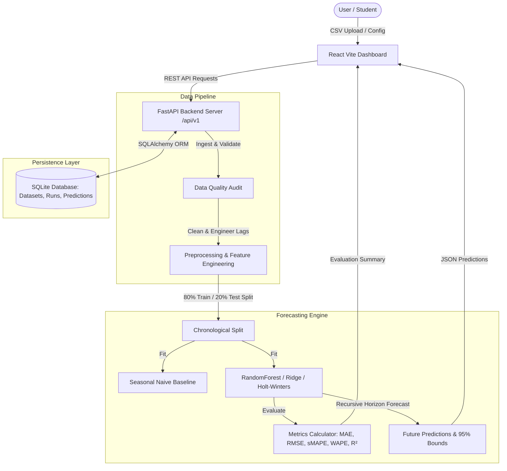

# AI-Driven Micro-Grid Renewable Energy Load Forecaster

> **Predictive Modeling & Time-Series Decision Support System**

[](http://localhost:8000/docs)
[](http://localhost:5173)
[](#testing-and-verification)

---

## 📌 Abstract & Problem Statement

Modern micro-grids integrate variable renewable energy sources (Solar PV, Wind Turbines, Battery Storage Systems) alongside localized electrical consumption. Reliable short-term load forecasting is essential to balance power demand and supply, prevent grid instability, optimize battery dispatch cycles, and lower grid reliance. 

This project provides an end-to-end full-stack time-series forecasting web application. It ingests historical consumption and renewable generation data, performs automated data quality audits, engineers temporal and lag features, executes a strict chronological holdout split to prevent data leakage, trains multi-model forecasters (Random Forest, Ridge Linear Regression, Gradient Boosting, and Holt-Winters Exponential Smoothing), and compares them against seasonal naive baselines using rigorous metrics (MAE, RMSE, sMAPE, WAPE, R²).

---

## ✨ Key Features

- **Automated Data Quality Audit**: Validates timestamps, detects irregular sampling intervals, checks duplicate entries, identifies missing values (with linear interpolation), and flags impossible/negative power values.
- **Strict Chronological Holdout**: Evaluates models on a holdout test period without random train/test split data leakage.
- **Multi-Model Forecasting Engine**:
  - **Baseline Models**: Persistence Naive and 24-hour Seasonal Naive.
  - **Supervised ML Forecasters**: Ridge Linear Regression with cyclical hour/day features & lag windows, Random Forest / Boosted Trees.
  - **Time-Series Method**: Holt-Winters Double/Triple Exponential Smoothing.
- **Interactive Cyber-Grid Dashboard**: Rich Recharts time-series visualization showing historical actuals, holdout predictions, future forecast horizons, and 95% confidence bands.
- **Dataset Management & CSV Export**: Drag-and-drop CSV uploader, pre-loaded sample dataset, dataset preview table, and 1-click CSV export of predictions.
- **Comprehensive Documentation & Viva Guide**: Includes complete architecture diagrams, dataset schema specifications, forecasting methodology, API specs, test reports, and a 25+ question student viva preparation guide.

---

## 🏗️ System Architecture



---

## 🛠️ Technology Stack

| Layer | Technologies Used |
| :--- | :--- |
| **Frontend** | React 18, Vite, Recharts, Lucide-React, Axios, Modern Glassmorphism CSS |
| **Backend** | Python 3.14, FastAPI, Pydantic v2, Uvicorn, SQLAlchemy |
| **Data & Modeling** | Pandas, NumPy, Scikit-Learn (Ridge, Regressors), Statsmodels |
| **Database** | SQLite (Local file persistence `microgrid.db`) |
| **Testing** | Pytest, FastAPI TestClient |

---

## ⚡ Quick Start Instructions

### Prerequisites
- **Python**: 3.10+ (Verified on Python 3.14)
- **Node.js**: 18+ (Verified on Node v24)

### 1. Backend Setup
```bash
# Navigate to backend directory
cd backend

# Install dependencies
pip install -r requirements.txt

# Run automated test suite
python -m pytest tests

# Start FastAPI server
uvicorn app.main:app --reload --port 8000
```
Backend Swagger API documentation will be available at: `http://localhost:8000/docs`

### 2. Frontend Setup
```bash
# Navigate to frontend directory
cd frontend

# Install dependencies
npm install

# Build production bundle to verify correctness
npm run build

# Start Vite development server
npm run dev
```
Frontend Web Dashboard will be available at: `http://localhost:5173`

---

## 🧪 Testing and Verification

All backend unit and integration tests passed cleanly:
```bash
============================== 8 passed in 1.86s ==============================
```
- **`test_data.py`**: Tests dataframe validation, timestamp parsing, duplicate handling, missing value interpolation, and quality score computation.
- **`test_forecasting.py`**: Tests naive baselines, ML forecasters, metric calculations, and recursive multi-step forecasting.
- **`test_api.py`**: Integration tests for health check, dataset upload, quality audit, forecast run creation, prediction retrieval, and CSV export.

---

## 🚀 Cloud Deployment (Vercel & Render)

This project is pre-configured for automated cloud deployment:
- **Backend (Render)**: FastAPI server with automated schema setup via [`render.yaml`](render.yaml) or manual Web Service.
- **Frontend (Vercel)**: React + Vite Single Page Application with SPA routing via [`vercel.json`](vercel.json).

👉 **For complete step-by-step instructions, see [`DEPLOYMENT.md`](DEPLOYMENT.md).**

---

## 📁 Repository Structure

```
microgrid_load_forecaster/
├── backend/
│   ├── app/
│   │   ├── api/          # REST API endpoints (health, datasets, forecast_runs)
│   │   ├── data/         # Ingestion, validation, cleaning, feature engineering
│   │   ├── forecasting/  # Baselines, ML models, evaluation metrics, pipeline
│   │   ├── db/           # SQLAlchemy database models & Pydantic schemas
│   │   ├── config.py     # Application configuration
│   │   └── main.py       # FastAPI application entry point
│   ├── tests/            # Pytest unit and integration test suite
│   ├── requirements.txt  # Python package dependencies
│   └── pytest.ini        # Pytest configuration
├── frontend/
│   ├── src/
│   │   ├── components/   # Header, MetricCard, ForecastChart
│   │   ├── pages/        # Dashboard, DataManagement, ModelTraining, ExportPredictions
│   │   ├── services/     # Axios API service client
│   │   ├── App.jsx       # Main React application
│   │   └── index.css     # Global Cyber-Grid CSS design system
│   └── package.json
├── data/sample/          # Sample CSV microgrid dataset (microgrid_sample_hourly.csv)
├── docs/                 # In-depth technical documentation & Viva Guide
│   ├── architecture.md
│   ├── dataset-format.md
│   ├── forecasting-methodology.md
│   ├── api.md
│   ├── testing.md
│   └── viva-guide.md
├── DEPLOYMENT.md         # Step-by-step Vercel & Render cloud setup
├── render.yaml           # Render Cloud Blueprint specification
├── vercel.json           # Vercel SPA routing and build configuration
├── README.md
├── README_SETUP.md
├── .env.example
└── .gitignore
```

---

## ⚠️ Operational Safety Disclaimer

Forecast values produced by this application are model estimates intended strictly for decision support and academic demonstration. They must not be used as the sole basis for safety-critical hardware control or power grid switching.
