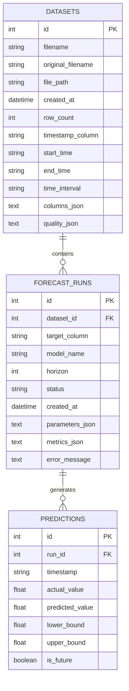

# System Architecture & Technical Specifications

This document outlines the detailed system architecture, data processing flow, machine learning pipeline, database schema, and REST API design for the **AI-Driven Micro-Grid Renewable Energy Load Forecaster**.

---

## 1. High-Level System Architecture

The application adopts a decoupled full-stack client-server architecture:

```
[ React 18 Frontend ] 
        │
        ▼ (Axios REST API Calls)
[ FastAPI Backend Server (/api/v1) ]
        │
        ├── Datasets & Ingestion API Router
        ├── Forecast Runs API Router
        └── Health Check Router
        │
        ▼
[ Data Processing & Quality Engine ]
        │
        ├── Ingestion & CSV Parsing
        ├── Data Quality Audit & Validation
        └── Preprocessing & Lag Feature Engineering
        │
        ▼
[ Time-Series Forecasting Pipeline ]
        │
        ├── Chronological Holdout Splitter (80/20)
        ├── Baseline Models (Naive & Seasonal Naive 24h)
        ├── Candidate Forecasters (RandomForest, Ridge, Holt-Winters)
        ├── Metric Calculator (MAE, RMSE, sMAPE, WAPE, R²)
        └── Recursive Multi-Step Horizon Forecast Generator
        │
        ▼
[ SQLite Database (microgrid.db) ]
```

---

## 2. Database ER Diagram & Schema

The application uses SQLAlchemy with SQLite to persist datasets, audit metadata, forecast configurations, evaluation metrics, and prediction values.



### Table Definitions
1. **`datasets`**: Stores metadata for ingested CSV files, including parsed column list, timestamp range, row count, detected sampling frequency, and full JSON data quality audit summary.
2. **`forecast_runs`**: Stores individual execution runs, model hyperparameter configurations, target signal, forecast horizon, status (`PENDING`, `RUNNING`, `COMPLETED`, `FAILED`), and calculated evaluation metrics.
3. **`predictions`**: Stores historical test holdout predictions (with actual vs predicted values) and future horizon forecasts (with 95% upper/lower bounds).

---

## 3. Data Processing & Validation Pipeline

1. **Ingestion & Validation**:
   - Parses uploaded CSV/Excel files safely.
   - Enforces 50MB maximum file size limit.
   - Converts timestamp column to standard ISO datetime.
   - Filters out unparseable rows and flags duplicate timestamps.
   - Computes statistical min, mean, max for all numeric columns.
   - Computes an overall **Data Quality Score** (0 to 100%).

2. **Feature Engineering**:
   - Extracts time-derived features: `hour`, `dayofweek`, `month`, `is_weekend`.
   - Encodes cyclical features: `hour_sin` ($\sin(2\pi \cdot \text{hour} / 24)$) and `hour_cos` ($\cos(2\pi \cdot \text{hour} / 24)$).
   - Generates target lag features: `target_lag_1`, `target_lag_2`, `target_lag_24`.
   - Computes rolling statistics: 6-hour and 24-hour rolling mean, 24-hour rolling standard deviation.

---

## 4. Forecasting & Evaluation Pipeline

1. **Chronological Holdout Split**:
   - To prevent data leakage, the dataset is split chronologically into an 80% Training Set and a 20% Test Set.
   - Scalers, feature transformers, and model fitting are strictly restricted to the Training Set.

2. **Multi-Step Recursive Forecasting**:
   - For future horizon forecasts beyond known historical data, the candidate ML model performs iterative autoregressive step-by-step forecasting, updating lag features dynamically at each step.

3. **Prediction Interval Calculation**:
   - Standard error of test residuals ($\sigma_e$) is computed on the holdout set.
   - 95% confidence bounds for future step $h$ are computed as:
     $$\hat{y}_{t+h} \pm 1.96 \cdot \sigma_e$$
